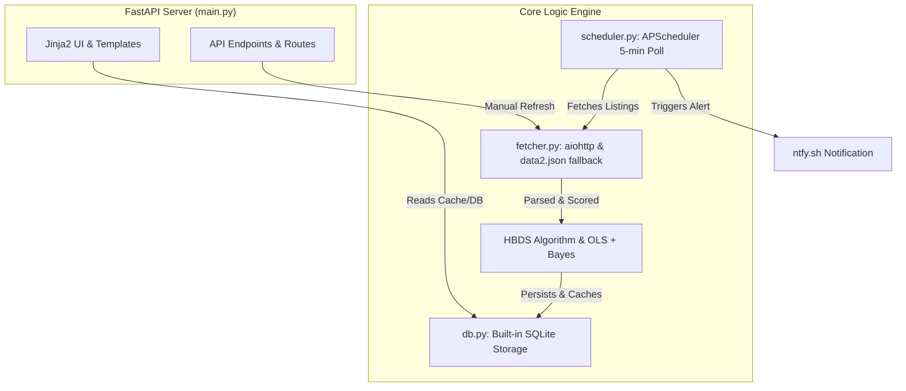

# Capo Finder Implementation Plan & Monitoring Document

## Project Summary & Architecture

**Capo Finder** is a production-ready Python web application built using **FastAPI**, **Jinja2**, **SQLite**, and **APScheduler**. It features the **HBDS (Hedonic-Bayesian Deal Scoring)** algorithm to identify top-tier deals and steals from listings, featuring real-time floor price tracking, automated background polling, and `ntfy.sh` push notifications.

---

## Beads Issues Table

| Claim Order | Issue ID | Title | Priority | Dependencies | Status |
| :--- | :--- | :--- | :--- | :--- | :--- |
| 1 | `char-finder-5ej` | [P1.1] Setup Project Environment with uv | P0 | None | [x] Closed |
| 2 | `char-finder-v6n` | [P2.1] Database Schema & Storage Handler (db.py) | P0 | `char-finder-5ej` | [x] Closed |
| 3 | `char-finder-2ee` | [P3.1] HBDS Algorithm & Data Fetcher (fetcher.py) | P0 | `char-finder-v6n` | [x] Closed |
| 4 | `char-finder-ctw` | [P4.1] Background Periodic Job & Ntfy Alerts (scheduler.py) | P1 | `char-finder-2ee` | [x] Closed |
| 5 | `char-finder-vbu` | [P5.1] UI Templates with Jinja2 & Minimal CSS (templates/) | P1 | `char-finder-2ee` | [x] Closed |
| 6 | `char-finder-r01` | [P6.1] FastAPI App & Server Integration (main.py) | P0 | `char-finder-vbu`, `char-finder-ctw` | [x] Closed |
| 7 | `char-finder-blk` | [P7.1] End-to-End Validation & Verification | P1 | `char-finder-r01` | [x] Closed |

---

## Execution Protocol

1. **Claim**: Select the next ready issue in claim order.
2. **Review**: Inspect rules in `CODING_RULES.md` and `/ponytail` principles (pure Python stats, zero pandas/numpy, clean SQLite parameterization).
3. **Implement**: Write clean, production-ready code.
4. **Test**: Run local validation via `uv run`.
5. **Close**: Run `bd close <issue-id>` to update tracking.

---

## Progress Tracker

- [x] Issue 1: `char-finder-5ej` Setup Environment
- [x] Issue 2: `char-finder-v6n` Database Schema
- [x] Issue 3: `char-finder-2ee` HBDS & Fetcher
- [x] Issue 4: `char-finder-ctw` Scheduler & Ntfy
- [x] Issue 5: `char-finder-vbu` Jinja2 UI Templates
- [x] Issue 6: `char-finder-r01` FastAPI Integration
- [x] Issue 7: `char-finder-blk` E2E Validation
